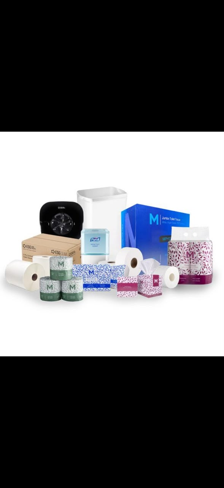

# 📸 VADORA Website - Image File Mapping

## ✅ Current Image Files and Usage

All your uploaded images are now correctly mapped in the website!

### Your Image Files:
```
assets/images/
├── logo.png                    ✅ Used
├── hygiene-products.jpg        ✅ Used
├── wholesale.jpg               ✅ Used
├── refuse-bags.webp            ✅ Used
├── paper-bags.webp             ✅ Used
├── vad.jpeg                    ✅ Used
├── vad1.jpeg                   ✅ Used
├── vad2.jpeg                   ✅ Used
└── vad3.jpeg                   ❌ Not currently used
```

---

## 🗺️ Where Each Image Appears:

### 1. **logo.png**
- **Location:** Navigation bar (top left)
- **Section:** Header navigation
- **Purpose:** Company branding

### 2. **hygiene-products.jpg**
- **Location:** Product Card #2
- **Section:** Products section
- **Title:** "Hygiene Products"

### 3. **vad.jpeg**
- **Location:** Product Card #1
- **Section:** Products section
- **Title:** "Cleaning Products"

### 4. **refuse-bags.webp**
- **Location:** Product Card #3
- **Section:** Products section
- **Title:** "Refuse Bags"

### 5. **paper-bags.webp**
- **Location:** Product Card #4
- **Section:** Products section
- **Title:** "Paper Bags"

### 6. **vad1.jpeg**
- **Location:** Product Card #5
- **Section:** Products section
- **Title:** "Office Consumables"

### 7. **wholesale.jpg**
- **Location:** Product Card #6
- **Section:** Products section
- **Title:** "Wholesale & Distribution"

### 8. **vad2.jpeg**
- **Location:** About Us section
- **Section:** About section (right side)
- **Purpose:** Showcase cleaning and hygiene supplies

### 9. **vad3.jpeg** ⚠️
- **Status:** Not currently used
- **Available for:** You can use this image to replace any of the above if needed

---

## 🔧 All Images Should Now Be Visible

After the updates, your website should display:
- ✅ Logo in navigation (top left)
- ✅ All 6 product cards with images
- ✅ About section image

### Refresh Your Browser
If images still don't show:
1. Press `Ctrl + F5` (Windows) or `Cmd + Shift + R` (Mac) to hard refresh
2. Clear your browser cache
3. Close and reopen the browser

---

## 📝 Technical Details

### Image Formats Used:
- **PNG:** logo.png (supports transparency)
- **JPG/JPEG:** hygiene-products.jpg, wholesale.jpg, vad.jpeg, vad1.jpeg, vad2.jpeg, vad3.jpeg
- **WebP:** refuse-bags.webp, paper-bags.webp (modern format, smaller file size)

### Browser Compatibility:
All formats (PNG, JPG, WebP) are supported by modern browsers.

---

## 🔄 To Replace an Image:

If you want to use **vad3.jpeg** instead of one of the current images:

1. Open `index.html`
2. Find the image you want to replace (search for the filename)
3. Change the filename to `vad3.jpeg`
4. Save and refresh your browser

### Example:
To replace the cleaning products image:
```html
<!-- Change from: -->


<!-- To: -->

```

---

## ✅ Status: All Images Mapped

All uploaded images (except vad3.jpeg) are now correctly referenced in your website and should be displaying properly!
